# 한글 양식 자동 작성 스킬 사용자 가이드

('26.11., v0.2.3)

## 한눈에 보기

- (무엇) 자주 쓰는 **한글(hwpx) 양식을 Claude에 주면, 그 서식 그대로** 보고서·매뉴얼을 만들어 주는 Claude 스킬
- (입력) 양식 파일 1개 + 내용(md·docx·여러 자료·대화로 쓴 글 무엇이든)
- (출력) 양식과 같은 모양의 **.hwpx 파일**(한글에서 바로 열림)

> ※ (핵심) 서식을 손으로 맞출 필요 없이, 양식에 실제로 쓰인 예시 문단에서 제목·글머리·표·박스 서식을 자동으로 읽어 그대로 적용

### 지원하는 양식 요소

| 구분 | 지원 내용 |
|---|---|
| 보고서(개조식) | 제목 상자, 날짜 줄, □ 대제목, ○ 글머리(굵은 머리말), ※ 주석·강조 박스, 붙임 상자(새 쪽) |
| 표 | 양식 표 서식(머리행 색), 셀 병합, 열 너비 지정 |
| 기타 | 문장 안 굵게, 각주, 그림·캡션, 머리말·꼬리말·쪽 번호 |
| 매뉴얼·가이드 | 표지·문서 정보·재개정 이력 유지, 목차 자동 생성(쪽 번호 포함) |

## 준비하기

### 사용 환경별 차이

| 환경 | 문서 생성 | 한글로 열어 검증 | .hwp 양식 자동 변환 | 목차 쪽 번호 |
|---|---|---|---|---|
| claude.ai(웹·앱) | 가능 | 불가(한글 없음) | 불가 → hwpx로 저장해 올림 | 빈칸(한글에서 입력) |
| Claude Code(Windows+한글) | 가능 | 가능 | 가능 | 자동 |

- (추천) 한글로 열어 검증까지 하려면 **Claude 데스크톱 앱의 Code 탭(Windows+한글)** 사용 — 설치부터 첫 문서까지 바로 아래 「Claude 데스크톱 앱으로 시작하기」에 화면과 함께 정리

### 양식 파일 준비

- (형식) 양식은 **.hwpx**로 준비(.hwp는 한글에서 「파일 → 다른 이름으로 저장 → 파일 형식 HWPX」)
- (예시 문단) 양식에 □·○·※·표·붙임 등 **실제로 쓰인 문단이 있어야** 그 서식을 읽음 — 빈 서식 파일보다 **완성된 기존 보고서**가 좋은 양식
- (보안) 대외비·개인정보가 담긴 문서는 소속 기관·회사의 보안 지침에 따라 업로드 여부 판단

## Claude 데스크톱 앱으로 시작하기(Windows)

처음 한 번만 하면 되는 설치부터 첫 문서 만들기까지 8단계입니다. 3단계부터는 GitHub에 직접 들어가지 않고 Code 탭에서 Claude에게 **말로 시켜서**(바이브 코딩) 진행합니다. 화면은 앱 버전에 따라 조금 다를 수 있습니다.

### 준비물

| 항목 | 내용 |
|---|---|
| PC | Windows 10·11(64비트) |
| Claude 계정 | Code 탭은 **유료 요금제(Pro·Max·Team·Enterprise)** 에서 사용 |
| 한글 | 한글 2018 이상(없어도 문서는 만들어짐, 한글로 열어 검증하는 단계만 빠짐) |
| Python | 4단계에서 Claude가 설치(따로 받을 필요 없음) |

### 1단계. 데스크톱 앱 내려받아 설치

- (1) 웹 브라우저에서 **claude.com/download** 접속(한국어 화면: claude.com/ko/download) → 「Windows용 다운로드」 클릭

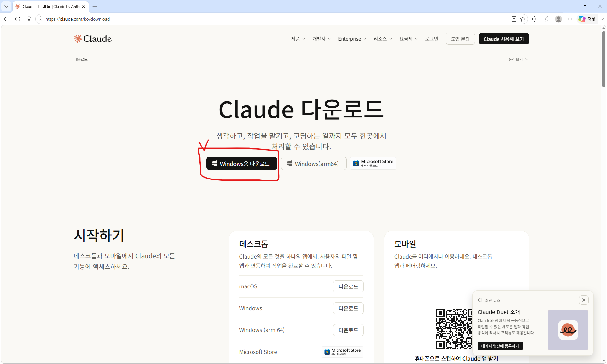{width=80%}

- (2) 파일 탐색기 「다운로드」 폴더의 **Claude Setup** 파일을 더블클릭(또는 오른쪽 클릭 → 「열기」) → 설치가 끝나면 앱이 저절로 열림
- (관리자 권한 불필요) 「관리자 권한으로 실행」은 고르지 않아도 됨
- (참고) 「Windows의 PC 보호」 창이 뜨면 「추가 정보 → 실행」. ARM 프로세서 PC는 다운로드 페이지의 「Windows(arm64)」 사용. 「Microsoft Store에서 다운로드」로 설치해도 됨

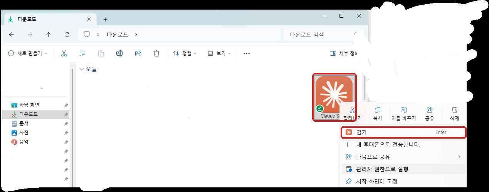{width=80%}

- (3) 설치가 끝나면 앱이 저절로 열림. 안 열렸거나 나중에 다시 열 때는 작업 표시줄 검색에 **claude** 입력 → 「Claude 앱」 → 「열기」

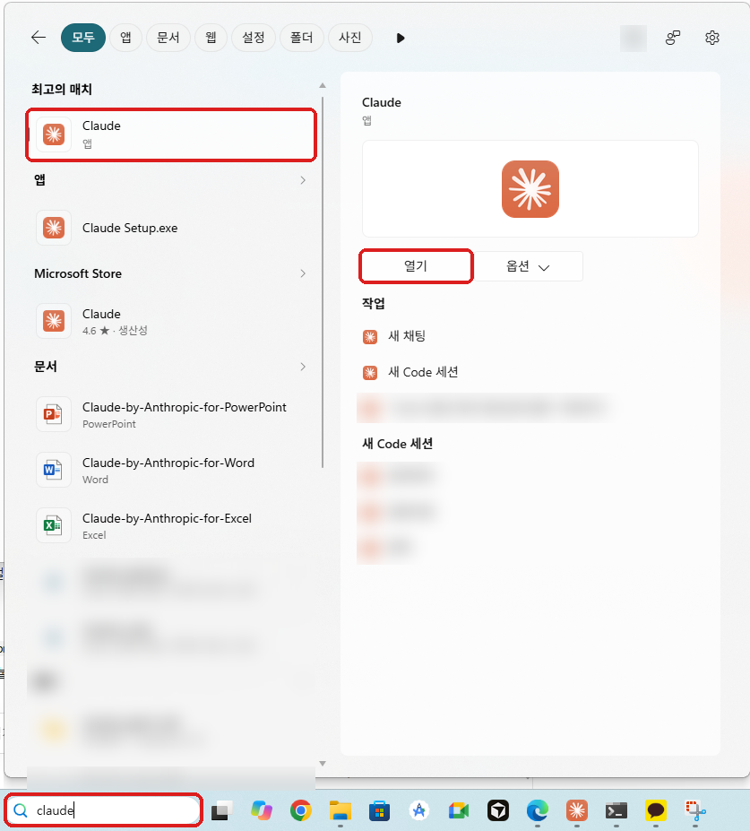{width=60%}

- (4) 앱 첫 화면 「로그인」에서 **「Google로 계속하기」** 클릭(claude.ai에서 쓰던 계정 그대로). 구글 계정이 아니면 이메일을 입력하고 「이메일로 계속하기」
- (5) 브라우저에 「계정을 선택하세요」가 뜨면 쓸 구글 계정 선택 → 「Claude에 다시 로그인하는 중입니다」에서 **「계속」** → 앱으로 돌아오면 로그인 끝

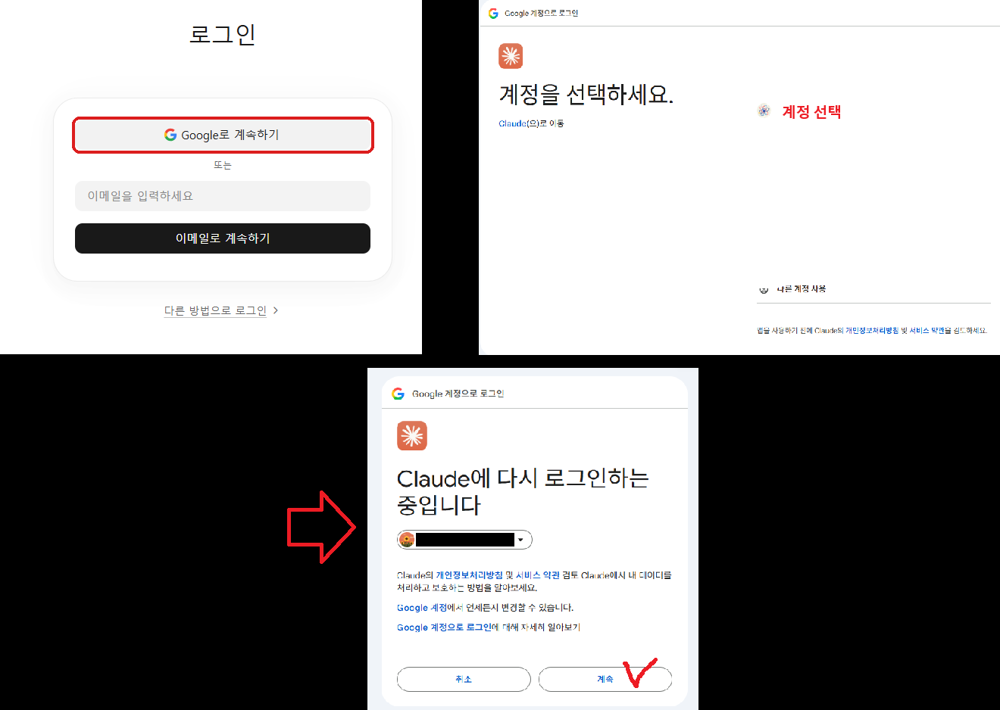{width=80%}

### 2단계. Code 탭 열기

- 왼쪽 사이드바 맨 위 오른쪽의 아이콘 2개 중 **`</>` 아이콘(Code 탭)** 클릭 — 왼쪽 말풍선 아이콘은 채팅 탭
- (Code 탭) 파일을 읽고, 명령을 실행하고, 한글로 검증까지 하는 곳
- (요금제 안내가 뜰 때) 무료 요금제에서는 Code 탭을 쓸 수 없음 → 유료 요금제로 바꾼 뒤 앱 다시 시작

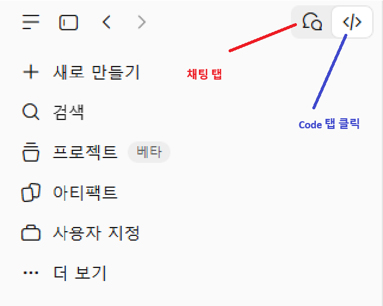{width=50%}

### 3단계. 작업 폴더 환경 만들기

- 여기부터는 GitHub에 직접 들어가지 않고, Code 탭에서 Claude에게 **말로 시켜서**(바이브 코딩) 설치까지 끝냄
- (1) 사이드바 **「+ 새로 만들기」** 로 새 세션 열기
- (2) 입력창 아래 왼쪽의 환경 표시(처음에는 「자동」) 클릭 → **「환경 선택」** → 목록 맨 아래 **「+ 새 환경」**
- (3) 「새 환경」 창에서 **「로컬」** 탭 → 이름은 `한글작업`, 실행 위치는 **「이 컴퓨터」**
- (4) 「폴더(선택 사항)」 오른쪽 **「+ 추가」** → **「선택…」**
- (5) 폴더 고르는 창에서 왼쪽 「문서」 클릭 → 위쪽 **「새 폴더」** → 이름을 `한글작업`으로 입력하고 Enter → 그 폴더를 고른 채 **「폴더 선택」**
- (6) 「새 환경」 창의 「폴더」에 `…\Documents\한글작업`이 들어갔는지 확인 → 창 아래 버튼으로 환경 저장
- (다음부터) 새 세션의 「환경 선택」에서 `한글작업`만 고르면 같은 폴더에서 시작

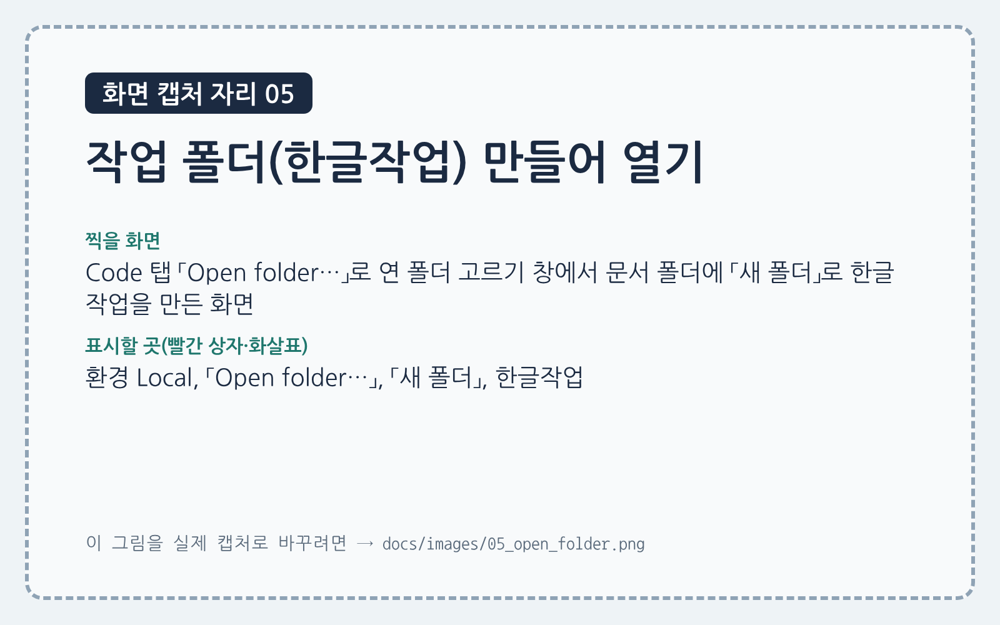{width=90%}

### 4단계. Python 설치(Claude에게 시키기)

- (1) `한글작업` 환경의 세션 입력창에 아래 문장을 **그대로 붙여 넣고** Enter

```
이 PC에 Python이 있는지 확인하고, 없으면 winget으로 Python 3.12를 설치해줘.
다 되면 설치된 버전을 알려줘.
```

- (2) Claude가 `python --version`, `winget install …` 같은 명령을 실행해도 되는지 물으면 명령을 확인하고 **허용**
- (3) 「Python 3.12.x 설치됨」처럼 버전이 보고되면 끝(이미 있으면 바로 「있음, 버전 ○○」으로 끝남)
- (python을 못 찾을 때) 새로 설치한 직후에는 앱이 python 명령을 못 찾을 수 있음 → 앱을 완전히 껐다 켜고, `한글작업` 환경으로 새 세션을 열어 「Python 설치 확인 다시 해줘」

### 5단계. 스킬 내려받고 작업 폴더 만들기(Claude에게 시키기)

- (1) 같은 세션에서 이어서 요청 — Claude가 GitHub에서 스킬 저장소를 내려받고, **양식**(모아 두는 곳)과 **작업**(작업마다 원고·자료·결과) 폴더로 나눔

```
https://github.com/emilyJ7/hwpx-template-public 저장소를 zip으로 내려받아
이 폴더의 _설치파일 폴더에 풀어줘. 그다음 이 폴더를 아래 구조로 정리해줘.
- 양식: 자주 쓰는 hwpx 양식을 모아 두는 곳(_설치파일의 examples\양식예시.hwpx 복사)
- 작업\2026-11_시험작성\원고, 자료, 결과 (원고에 examples\sample.md 복사)
```

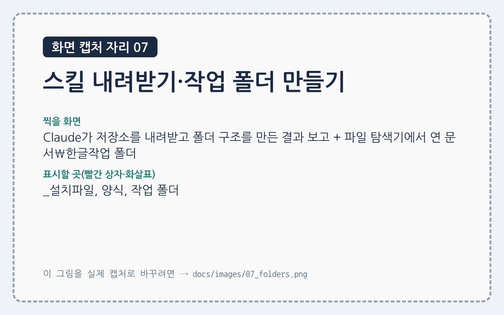{width=80%}

- (2) 내려받기·압축 풀기·폴더 만들기·복사 승인을 묻으면 위치가 `문서\한글작업` 안인지 확인하고 **허용**
- (3) Claude가 완료를 보고하면 파일 탐색기에서 `문서\한글작업`을 열어 아래처럼 되어 있는지 확인

```
문서\한글작업
├─ _설치파일\(내려받은 스킬 저장소)
├─ 양식\양식예시.hwpx
├─ 작업\2026-11_시험작성\원고\sample.md
├─ 작업\2026-11_시험작성\자료\
└─ 작업\2026-11_시험작성\결과\
```

- (다음 작업부터) 「작업 폴더에 2026-12_월간보고를 같은 구조로 만들어줘」 한 줄이면 됨

### 6단계. 스킬을 Claude 앱에 넣기

- (1) 먼저 같은 세션에서 스킬이 쓰는 Python 패키지 설치를 요청(승인 창이 뜨면 `pip install`인지 확인하고 허용)

```
_설치파일의 requirements.txt로 필요한 Python 패키지를 설치하고 버전을 알려줘.
```

- (2) 왼쪽 아래 내 이름(프로필) 클릭 → **「설정」**
- (3) 설정 왼쪽 목록 「사용자 지정」 아래 **「Skills」** 클릭
- (4) 오른쪽 위 **「+ 추가」** 클릭
- (한글 자동 검증까지) 한글 파일 접근 승인 창을 매번 누르기 싫으면 「_설치파일의 setup_windows.ps1을 -RegisterSecurityModule 옵션으로 실행해줘」를 요청

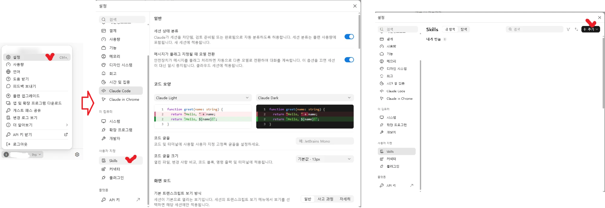{width=100%}

- (5) 메뉴에서 **「Skill 업로드」** → 「Skill 파일」 칸의 업로드 표시(↑)를 클릭(또는 파일을 칸에 끌어다 놓기)
- (6) 「열기」 창에서 `문서\한글작업\_설치파일` 안 `dist` 폴더로 이동 → **hwpx-template-skill**(압축 파일) 선택 → **「열기」**(zip을 풀거나 다시 압축하지 말고 그대로)
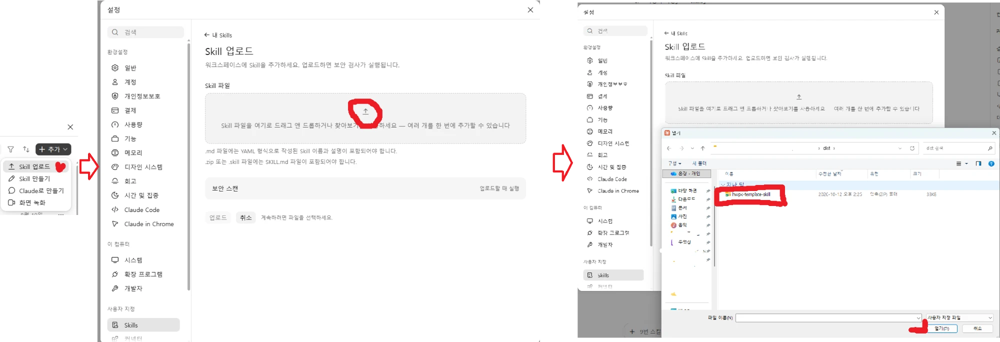{width=100%}

- (7) 「Skill 파일」에 `hwpx-template-skill.zip`, 「미리보기」에 hwpx-template 설명이 보이면 **「업로드」** 클릭(보안 스캔이 함께 실행됨)
- (8) Skills 화면 「내가 만듦」 목록에 **hwpx-template**(파일 및 문서)이 보이면 끝

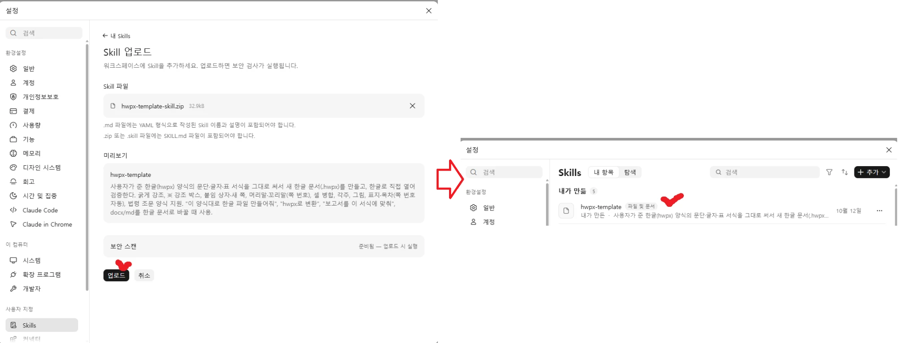{width=100%}

### 7단계. 설치 확인

- (1) 사이드바 「+ 새로 만들기」로 **새 세션** → 「환경 선택」에서 `한글작업` 선택(설치 전에 열려 있던 세션에는 스킬이 반영되지 않음)
- (2) 입력창에 `/hwpx` 입력 → 목록에 **anthropic-skills:hwpx-template** 이 보이면 성공(설정의 Skills로 올린 스킬은 이 이름으로 보임)
- (3) 목록에서 고르면 입력창 맨 앞에 `/anthropic-skills:hwpx-template`이 들어감 → 그 뒤에 요청 문장을 이어서 씀

### 8단계. 첫 문서 만들기

- (1) 7단계 세션(`한글작업` 환경)에서 요청 문장 입력 — 다른 곳의 파일은 입력창 옆 **+** 버튼으로 첨부하거나 입력창에 끌어다 놓아도 됨

```
/anthropic-skills:hwpx-template 양식\양식예시.hwpx 양식에 맞게 작업\2026-11_시험작성\원고\sample.md를
한글 파일로 만들어 같은 작업의 결과 폴더에 시험보고.hwpx로 저장해줘.
다 만들면 한글로 열어 검증하고 쪽 수를 알려줘.
```

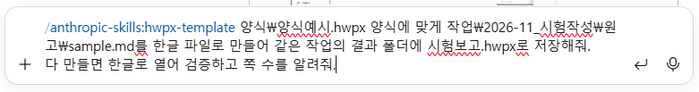{width=80%}

- (2) Claude가 양식 분석 → 원고 정리 → hwpx 생성 → 한글로 열어 검증 순서로 진행(중간에 승인 창이 뜨면 확인 후 허용, 한글 창이 잠깐 열렸다 닫힐 수 있음)
- (3) Claude가 「완료」와 함께 결과 파일 경로·쪽 수·검증 결과를 보고하면 끝
- (4) 파일 탐색기에서 `문서\한글작업\작업\2026-11_시험작성\결과\시험보고.hwpx`를 더블클릭 → 한글에서 제목 상자·□·○ 글머리·표·※ 박스가 양식과 같은 모양인지 확인
- (5) 고칠 점은 같은 세션에서 이어서 요청(예: 「표 첫 열을 더 넓게 해서 다시 만들어줘」)

> ※ (멈추고 싶을 때) 입력창 옆 정지 버튼 또는 Esc. 방향을 바꾸려면 멈추지 않고 새 요청을 입력해도 됨

## 다른 설치 방법

### claude.ai(웹·데스크톱 앱)

- (1) 저장소에서 `dist/hwpx-template-skill.zip` **파일 하나만** 내려받기(폴더째 압축 금지)
- (2) claude.ai 왼쪽 아래 프로필 → **설정 → 기능(Capabilities)** 에서 「코드 실행 및 파일 생성」 켜기
- (3) 같은 화면의 **스킬(Skills) → 스킬 업로드**에서 zip 선택 → 목록에 hwpx-template이 보이고 켜져 있으면 완료
- (4) 새 대화에서 사용(이미 열려 있던 대화에는 반영되지 않음)

※ 업로드 오류 「Zip cannot contain nested zip files」 → zip 안에 zip이 든 것(폴더째 압축). 내려받은 zip을 그대로 올림

### Claude Code(플러그인·터미널)

- (플러그인) `/plugin marketplace add emilyJ7/hwpx-template-public` → `/plugin install hwpx-template@hwpx-tools`
- (폴더 복사) `skills/hwpx-template` 폴더를 `C:\Users\<사용자>\.claude\skills\`에 복사, 또는 `setup_windows.ps1 -CopySkill` 실행
- (한글 검증용) `setup_windows.ps1` 실행(파이썬 패키지 설치·한글 확인), 새 대화에서 `/hwpx-template`으로 호출

### 다른 AI 도구(Codex·Cursor·Gemini CLI·GitHub Copilot)

이 스킬은 여러 AI 도구가 함께 쓰는 공개 표준(Agent Skills, `SKILL.md`) 형식이라, 스킬 폴더를 각 도구가 읽는 위치에 복사하면 됩니다.

| 도구 | 개인 폴더(모든 프로젝트) | 프로젝트 폴더 | 쓰는 법 |
|---|---|---|---|
| Claude Code | `~/.claude/skills/` | `.claude/skills/` | `/hwpx-template` 또는 요청하면 자동 선택 |
| OpenAI Codex | `~/.agents/skills/` | `.agents/skills/` | `$hwpx-template` 또는 요청하면 자동 선택 |
| Cursor | `~/.cursor/skills/` 또는 `~/.agents/skills/` | `.cursor/skills/` 또는 `.agents/skills/` | 요청하면 자동 선택 |
| Gemini CLI | `~/.gemini/skills/` 또는 `~/.agents/skills/` | `.gemini/skills/` 또는 `.agents/skills/` | 요청하면 사용 동의 후 실행(`/skills list`로 확인) |
| GitHub Copilot(VS Code) | `~/.copilot/skills/` 또는 `~/.agents/skills/` | `.github/skills/` 또는 `.agents/skills/` | 에이전트 모드에서 요청 |

- (한 번에) `~`는 사용자 폴더(Windows는 `C:\Users\<사용자>`). `skills/hwpx-template` 폴더를 `~/.agents/skills/hwpx-template`에 복사하면 Codex·Cursor·Gemini CLI·Copilot이 함께 읽음 — `setup_windows.ps1 -CopySkill -Agents`
- (필요 환경) 모든 도구에서 Python과 `lxml`이 필요(`python -m pip install -r requirements.txt`). 한글로 열어 검증하는 단계는 Windows+한글 PC에서, 도구가 명령 실행을 허용할 때만 동작 — 승인 창이 뜨면 허용
- (참고) Gemini CLI는 Antigravity CLI로 바뀌는 중이라고 공지됨. 바뀐 도구에서는 그 문서의 스킬 위치를 확인

## 기본 사용 흐름

- (1단계) 대화창에 **양식 hwpx**와 **내용 파일**을 첨부(또는 내용을 직접 입력)
- (2단계) 「이 양식에 맞게 ○○를 한글 파일로 만들어줘」 요청
- (3단계) Claude가 양식 분석 → 원고 정리 → hwpx 생성(Claude Code는 한글로 열어 검증까지)
- (4단계) 결과 hwpx를 내려받아 한글에서 확인, 고칠 점은 대화로 다시 요청

> ※ (요청 요령) ① 어떤 양식으로 ② 무엇을(파일·내용) ③ 어떤 문서로(분량·어투·대상) ④ 특별 요청(붙임, 표, 강조할 점)을 함께 적으면 한 번에 원하는 결과에 가까워짐

## 케이스별 프롬프트 예시

### 케이스 1. Markdown(md) 파일을 양식으로

- (상황) 정리해 둔 md 문서를 보고서 양식으로 바꾸고 싶을 때
- (첨부) 보고양식.hwpx, 원고.md

```
hwpx-template 스킬로, 첨부한 보고양식.hwpx 양식에 맞게 원고.md 내용을 한글 파일로 만들어줘.
md의 ## 제목은 □ 대제목으로, 목록은 ○ 글머리로 바꾸고 표는 양식 표 서식으로 넣어줘.
```

- (팁) md의 굵게 표시(별표 두 개로 감싼 글)는 굵은 글자로, 「>」로 시작하는 줄은 ※ 강조 박스로 들어감

### 케이스 2. Word(docx) 문서를 양식으로

- (상황) 받은 docx 보고서를 쓰고 있는 한글 양식으로 옮길 때
- (첨부) 보고양식.hwpx, 보고서.docx

```
보고서.docx를 첨부한 보고양식.hwpx 서식으로 변환해서 한글 파일로 만들어줘.
docx의 표와 그림, 각주는 그대로 살리고, 제목 단계는 양식의 □/○ 구조에 맞춰줘.
```

- (팁) docx의 병합 셀·열 너비·그림·각주까지 옮겨짐. 문장은 원문 그대로 두려면 「문장은 고치지 말고」를 덧붙임

### 케이스 3. 여러 자료를 요약해 보고서로

- (상황) 회의자료·참고 PDF·엑셀 등 여러 파일을 1~2쪽 보고서로 정리할 때
- (첨부) 보고양식.hwpx, 자료1.pdf, 자료2.docx, 통계.xlsx

```
첨부한 자료 3개를 읽고 팀장 보고용으로 2쪽 이내 요약 보고서를 만들어줘.
구성은 □ 현황 □ 문제점 □ 대응방안 □ 향후 일정, 개조식(~함, ~필요)으로 쓰고
핵심 수치는 표 1개로 정리해줘. 상세 근거는 붙임1로 빼줘. 양식은 보고양식.hwpx를 써.
```

- (팁) 분량·구성·대상(누구에게 보고)·어투를 지정하면 결과가 안정적. 출처가 필요하면 「근거 자료명은 각주로」 추가

### 케이스 4. 대화로 쓴 글·메모를 양식으로

- (상황) 따로 파일 없이, 생각나는 대로 적은 내용을 보고서 형식으로 만들 때
- (첨부) 보고양식.hwpx

```
아래 메모를 첨부 양식에 맞춰 1쪽 보고서로 만들어줘. 제목은 「OO 추진 현황」, 날짜는 오늘.
- 9월 착수, 11월 중간보고 예정
- 1차 기능 개발 완료, 사용자 시험 진행 중
- 일정 지연 우려 → 인력 보강 검토 필요
```

- (팁) 메모가 짧으면 Claude가 문장을 다듬어 개조식으로 채움. 사실 추가를 원치 않으면 「메모에 없는 내용은 넣지 마」

### 케이스 5. 표·그림·각주가 들어간 문서

- (상황) 데이터 표, 그래프 이미지, 출처 각주가 필요한 보고서
- (첨부) 보고양식.hwpx, 데이터.csv, 그래프.png

```
데이터.csv를 연도별 표로 정리하고 그래프.png를 「그림 1」 캡션과 함께 넣어서
첨부 양식으로 보고서를 만들어줘. 수치 출처는 각주로 달아줘.
표의 「구분」 열은 위아래 같은 값끼리 병합해줘.
```

- (팁) 그림 크기는 「본문 폭의 70%로」처럼 지정 가능

### 케이스 6. 본문 + 붙임이 있는 보고서

```
본문은 1쪽으로 요약하고, 상세 비교표는 붙임1, 관련 참고 자료는 붙임2로 따로 만들어줘.
붙임은 양식의 붙임 상자 모양으로 새 쪽에서 시작해줘.
```

- (팁) 양식에 「붙임1」 상자가 있으면 그 모양을 그대로 씀

### 케이스 7. 표지·목차가 있는 매뉴얼 양식

- (상황) 표지·문서 정보·재개정 이력·목차가 있는 가이드 양식으로 긴 문서를 만들 때
- (첨부) 매뉴얼양식.hwpx, 원고.md

```
매뉴얼양식.hwpx 양식으로 원고.md를 만들어줘.
표지 제목은 「OO 시스템 사용자 가이드」, 버전 0.1, 날짜 2026. 10.로 바꾸고
표지 로고는 빼줘. 재·개정 이력 표는 비우고 「0.1 / 2026-10-12 / 최초작성」 한 줄만 넣어줘.
목차는 원고 제목으로 새로 만들어줘.
```

- (팁) 목차 쪽 번호는 Claude Code(Windows+한글)에서 자동, claude.ai에서는 빈칸 → 한글에서 확인 후 입력

### 케이스 8. 결과 고치기(다시 요청)

```
- 표의 첫 열을 더 넓게(25%) 해줘
- 문장을 모두 「~함」 체로 바꾸고 2쪽 안에 들어가게 줄여줘
- 3번 대제목 아래에 ※ 박스로 「법률 자문 결과」를 추가해줘
- 머리말에 「대외비」를 오른쪽에 넣고 쪽 번호를 - 1 - 모양으로 넣어줘
```

- (팁) 같은 대화에서 이어서 요청하면 앞의 양식 분석을 그대로 이어 씀

### 케이스 9. hwp 파일밖에 없을 때

- (claude.ai) 한글에서 양식을 열어 **HWPX로 저장**한 뒤 업로드
- (Claude Code + 한글) .hwp 그대로 주면 자동 변환(원본은 그대로 둠)

```
C:\양식\보고양식.hwp 양식으로 회의결과.md를 한글 파일로 만들어 test 폴더에 저장해줘.
```

## 데스크톱 앱(Code 탭) 프롬프트 예시

Code 탭에서는 PC의 폴더와 파일을 직접 다루므로, 첨부 대신 **파일 경로·폴더 이름**으로 요청할 수 있습니다. 아래 문장을 복사해 파일 이름만 바꿔 쓰면 됩니다.

- (스킬 부르기) 설정의 Skills로 올렸다면 `/anthropic-skills:hwpx-template`, 플러그인·폴더 복사로 설치했다면 `/hwpx-template`. `/` 없이 「hwpx-template 스킬로 …」라고 써도 됨

### 설치·점검

```
hwpx-template 스킬이 설치돼 있는지, Python과 lxml이 있는지, 한글로 열어 검증할 수 있는 상태인지 점검해줘.
없는 것이 있으면 설치 방법을 단계별로 알려줘.
```

```
setup_windows.ps1을 -CopySkill -RegisterSecurityModule 옵션으로 실행해서 다시 설치해줘.
```

### 양식부터 확인하기

```
/anthropic-skills:hwpx-template 양식\보고양식.hwpx 양식을 분석만 해줘. 제목 상자, □·○·- 글머리, ※ 박스, 표,
붙임 상자 중 무엇이 인식됐고 무엇이 없는지 표로 정리해줘. 아직 문서는 만들지 마.
```

- (팁) 새 양식을 처음 쓸 때 먼저 확인하면, 빠진 서식을 양식에 예시 문단으로 추가해 다시 줄 수 있음

### 폴더 안 파일로 바로 만들기

```
/anthropic-skills:hwpx-template 양식\보고양식.hwpx 양식으로 원고\11월_추진현황.md를 한글 파일로 만들어
결과 폴더에 같은 이름(.hwpx)으로 저장해줘. 한글로 열어 검증하고 쪽 수와 표 개수를 알려줘.
```

```
원고 폴더의 docx 파일 3개를 각각 양식\보고양식.hwpx 서식으로 바꿔서 결과 폴더에 저장해줘.
파일마다 한글 검증 결과를 표로 정리해줘. 문장은 고치지 마.
```

### 여러 자료를 모아 보고서로

```
자료 폴더의 PDF·엑셀·docx를 모두 읽고 국장 보고용 2쪽 보고서를 양식\보고양식.hwpx로 만들어줘.
구성: □ 추진 배경 □ 현황 □ 문제점 □ 개선 방안 □ 향후 계획
어투는 개조식(~함, ~필요), 핵심 수치는 표 1개, 출처는 각주로, 상세 비교는 붙임1로.
결과는 결과\개선방안_보고.hwpx로 저장하고 한글로 검증해줘.
```

- (팁) 「메모에 없는 내용은 넣지 마」 「수치는 원자료 그대로」를 덧붙이면 내용이 바뀌는 것을 막음

### 매달 같은 양식으로 반복

```
지난달 결과\10월_월간보고.hwpx와 같은 양식·구성으로, 원고\11월_메모.md 내용을 넣어
결과\11월_월간보고.hwpx를 만들어줘. 날짜는 2026. 11. 30.으로 바꿔줘.
```

```
이번에 쓴 요청 문장과 양식 경로를 다음 달에도 쓸 수 있게 요청문.md 파일로 정리해서 저장해줘.
```

### 결과 다듬기

```
결과\주간보고.hwpx에서 표 첫 열을 25%로 넓히고, 2쪽 안에 들어가게 문장을 줄여서 다시 만들어줘.
고친 뒤 한글로 열어 쪽 수가 2쪽인지 확인해줘.
```

```
한글로 연 결과를 쪽별 그림(PNG)으로 저장해서 양식과 비교해줘. 다른 점이 있으면 고쳐서 다시 만들어줘.
```

### hwp 양식·매뉴얼

```
/anthropic-skills:hwpx-template C:\양식\업무매뉴얼.hwp 양식으로 원고\사용자가이드.md를 만들어줘.
표지 제목은 「OO 시스템 사용자 가이드」, 버전 1.0, 날짜 2026. 11.로 바꾸고 목차는 새로 만들어
쪽 번호까지 채워줘. 원본 hwp는 건드리지 마.
```

> ※ (승인 창) 파일을 만들거나 명령을 실행할 때 승인을 물으면, 작업 폴더 안의 일인지 확인하고 허용. 자주 묻는 것이 번거로우면 권한 모드를 「Accept edits」로 바꿈(파일 편집은 자동, 그 밖의 명령은 계속 물음)

## 잘 쓰는 요령

- (좋은 양식) 빈 서식보다 **실제로 작성된 기존 문서**를 양식으로 — 제목·글머리·표·박스 예시가 있어야 그 모양을 읽음
- (한 번에) 대상·분량·구성·어투·붙임 여부를 첫 요청에 함께 적기
- (확인) 결과는 반드시 한글에서 열어 수치·고유명사 확인(요약 과정에서 표현이 바뀔 수 있음)
- (다른 기관 양식) 빌려 쓴 양식이면 로고·담당자 실명이 남지 않게 「로고 빼고, 이력 표 비워줘」 요청
- (재사용) 자주 쓰는 양식과 잘 된 요청 문구를 따로 모아 두고 다시 씀

## 자주 묻는 질문

| 질문 | 답 |
|---|---|
| 스킬이 안 보여요 | 설치 후 **새 대화**를 열어야 반영. claude.ai는 설정 → 기능 → 스킬에서 켜져 있는지 확인 |
| 업로드 시 「nested zip」 오류 | zip 안에 zip이 있음. 받은 zip 파일을 그대로 업로드 |
| 「SKILL.md가 필요」 오류 | 폴더를 다시 압축하지 말고 배포된 zip을 그대로 사용 |
| 서식이 양식과 조금 달라요 | 양식에 해당 요소 예시가 없는 경우. 예시가 있는 문서를 양식으로 쓰거나 「○○ 서식은 △△처럼」 요청 |
| 한글에서 안 열려요 | 결과 파일명·양식 정보를 알려 재생성 요청(Claude Code는 한글 검증으로 사전 차단) |
| Code 탭을 누르면 요금제 안내가 떠요 | Code 탭은 유료 요금제에서 사용. 요금제를 바꾼 뒤 앱을 다시 시작 |
| 「python을 찾을 수 없음」 | Python을 새로 설치한 직후면 앱을 완전히 껐다 켜고 다시 요청. 그래도 안 되면 「Python이 PATH에 있는지 확인하고 고쳐줘」 |
| Git 설치를 요구해요 | git-scm.com에서 Git for Windows 설치 후 앱 다시 시작 |
| `/`를 눌러도 hwpx-template이 없어요 | 새 세션을 열었는지 확인. `C:\Users\<사용자>\.claude\skills\hwpx-template\SKILL.md`가 있는지 Claude에게 확인 요청 |
| 한글 창에서 접근 허용을 계속 물어요 | 「모두 허용」 클릭, 또는 `setup_windows.ps1 -RegisterSecurityModule`로 보안 승인 모듈 등록 |
| 목차 쪽 번호가 비어요 | claude.ai에는 한글이 없어 쪽 계산 불가 → 한글에서 확인 후 입력, 또는 Claude Code 사용 |

## 유의사항

- (보안) 대외비·개인정보 문서는 소속 기관·회사 지침에 맞는지 확인한 뒤 업로드
- (책임) 생성 문서의 내용 확인과 사용 책임은 작성자에게 있음
- (한계) 셀 병합은 표 단위로 지원, 여러 구역(가로·세로 혼합) 양식은 첫 구역 서식만 사용, 같은 각주 재참조 불가

## 예시 파일로 바로 해 보기

- (견본 양식) `examples/양식예시.hwpx` — 제목 상자, □·○·- 글머리, ※ 박스, 표, 붙임 상자가 들어 있는 시험용 보고서 양식
- (원고) `examples/sample.md` — 위 요소를 모두 쓰는 짧은 원고
- (결과) `examples/결과예시.hwpx`, `examples/결과예시.pdf` — 두 파일로 만든 결과

```
examples/양식예시.hwpx 양식에 맞게 examples/sample.md 내용을 한글 파일로 만들어줘.
```

## 더 보기

- 슬라이드판 사용자 가이드: `docs/사용자가이드.pptx`
- 원고 문법 상세: `skills/hwpx-template/USAGE.md`
- 발표자료(15장): `docs/발표자료/발표자료.pptx`, PDF `docs/발표자료/발표자료.pdf`, 대본 `docs/발표자료/발표대본.md`
- 문제 신고·제안: GitHub 저장소의 Issues
